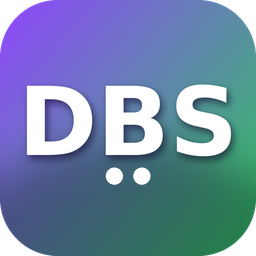
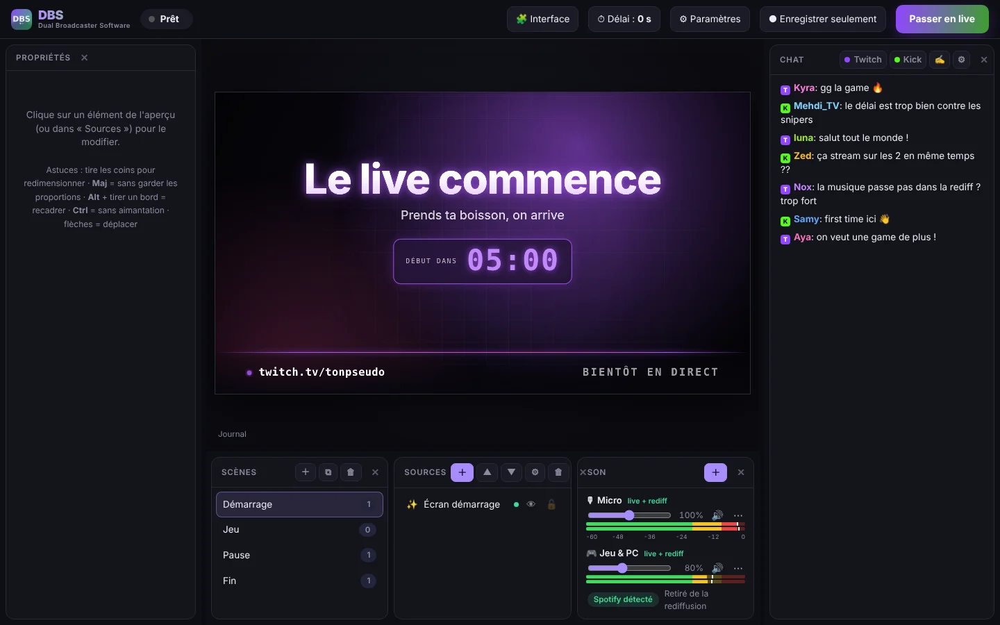

<h1 align="center">DBS · Dual Broadcaster Software</h1>

<b>Stream sur Twitch et Kick en même temps, avec des rediffusions sans musique copyright.</b> 
Gratuit · Windows 10 &amp; 11

  <a href="https://github.com/NezuFR/DBS/releases/latest/download/DBS-Windows.zip"><b>⬇ Télécharger pour Windows</b></a> ·
  <a href="https://nezufr.github.io/DBS/">Site officiel</a> ·
  <a href="https://github.com/NezuFR/DBS/issues">Signaler un problème</a>

## Fonctionnalités

- 📡 **Twitch + Kick en même temps**, avec reconnexion automatique
- 🎵 **Rediffusion sans musique** : Spotify (ou une autre appli) est entendu en live mais retiré de la vidéo enregistrée
- 🎬 **Scènes et sources** : jeu, écran, webcam, images, vidéos, textes, overlays web (alertes, chat, trackers…)
- ✨ **Écrans animés** Démarrage / Pause / Fin avec compte à rebours
- ⏱ **Délai anti stream-sniping** réglable en plein live, sans couper le stream
- 🎚 **Son complet** : plusieurs micros, entrées et sorties audio, vumètres en temps réel
- 💬 **Chat Twitch + Kick réuni**
- ⌨ **Raccourcis clavier** qui marchent même en jeu
- 🚀 **Léger** : encodage par la carte graphique, le moins de FPS perdus possible
- 🌐 **9 langues** : français, English, español, 中文, 日本語, 한국어, русский, türkçe, português

## Installation

1. Télécharge **DBS-Windows.zip** dans [Releases](https://github.com/NezuFR/DBS/releases/latest).
2. Clic droit › « Extraire tout… ».
3. Lance **DBS.exe**.
   Si Windows affiche « Windows a protégé votre ordinateur » : « Informations complémentaires » › « Exécuter quand même »
   (DBS n'est pas encore signé numériquement).
4. ⚙ Paramètres › ajoute tes clés de stream Twitch / Kick.

## Un problème ?

Ouvre un [ticket](https://github.com/NezuFR/DBS/issues) et joins le fichier `journal.txt` qui se trouve à côté de DBS.exe.
